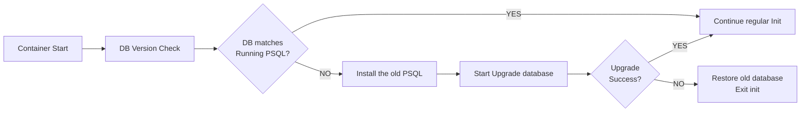

# Upgrading to a newer version of PostgreSQL

## Important update

Something I've been wanting to do for along time was to have an in-place update process for the database. This is now done! So the instructions below are still valid for a manual update (or backup), but are not fully required.

### What changed?

In the init script of the database, there is now a version check. If the database version does not match the version of PostgreSQL that is running, then the old version of postgresql will be downloaded, started, and the database is dumped, then re-imported in the newer version psql. Everything happens inside the container, and the old version is then removed.

This means that the container needs internet access. If not, the upgrade process will fail, and you will have to do a manual upgrade as below.

Also, the upgrade process takes a little while (download psql, check db, upgrade db, cleanup, etc...) but this needs to be done only once.

See what a [successful log looks like](https://github.com/abesnier/docker-guacamole/blob/master/Examples/upgradeSuccess.txt), and what a [failed one does](https://github.com/abesnier/docker-guacamole/blob/master/Examples/upgradeFailed.txt).

## Why?

If you inspect the Dockerfiles in this repo, you will notice that the base image I use for the `1.4.0` or `latest` tags is `tomcat:9.0.67-jre11` (at the time of writing this guide). 

This image in turn is based on Ubuntu Jammy (22.04.4 LTS). And this version of Ubuntu comes with [postgresql-14 ](https://packages.ubuntu.com/jammy/postgresql) in its official 
repositories. 

Now, that is a problem for me, as my images used to use postgresql-13. So I need to [add the postgresql repositories](https://github.com/abesnier/docker-guacamole/blob/eb34d1dc10c63cc6f55eb146504ae8d4c235ad9a/Dockerfile.ubuntu#L80) to be able to install 
postgresql-13. (and for those who were looking for a replacement of Oznu's original image when Guacamole 1.4.0 came out, that was a problem too at the time). 

And I don't like that, so in the future, I will slowly try to migrate my images to the version of postgresql available in the base repositories.

These instructions can be used to upgrade from any version of PostgreSQL to a newer version (meaning, you can use these instructions to upgrade from [oznu's image](hub.docker.com/r/oznu/guacamole/)).

## Is this a problem for the users?

Yes, because databases are not compatible between major versions of postgresql and [an upgrade is required](https://www.postgresql.org/docs/current/release-14.html#id-1.11.6.9.4). 

If you try to upgrade in place (just upgrade from a postgresql-13 image to a postgresql-14 image), postgresql server will start, but will spew errors, telling you that the databases were created with an inferior version, and you will not be able to log in to guacamole, or use your previously setup connections. 

That is not ideal to be frank.

## Then how do I upgrade?

Thankfully, the upgrade process *should* be quite easy: 
1. Make a backup of your config directory `cp -r /path/to/config /path/to/config-backup` 
2. Start a container with a postgresql-13 image (or make sure one is running), e.g. `abesnier/guacamole:latest` 
3. Run `docker exec -it guacamole bash -c "pg_dump -U guacamole -F t guacamole_db > guacamole_db_backup.tar"` 
4. Stop the container 
5. Start a container with a postgresql-14 image, e.g. `abesnier/guacamole:latest-pg14` 
6. Confirm it is running a postregsql 14 instance: `docker exec -it guacamole bash -c "psql --version"`.
    
    This should return something like: `psql (PostgreSQL) 14.3 (Ubuntu 14.3-0ubuntu0.22.04.1)`
    
7. Run `docker exec -it guacamole bash -c "pg_restore -d guacamole_db guacamole_db_backup.tar -c -U guacamole"` 
8. If the above command returns an error, check the logs (`docker logs guacamole`) and confirm that PostgreSQL is running. It may not have been able to start, as the sql files already present in the config/postgres directory are not compatible from PG13 to PG14. In that case, stop the container, and delete the config/postegres directory. Make sure that your `guacamole_db_backup.tar` is safe!! Once deleted, restart the pg14 container, and run the command above one more time.
9. Open your browser to your guacamole home page, and confirm it works. It should.

## Are you sure?

Well, a little. I can confirm these are the steps I followed for my use case, and it worked. I am now running latest-pg14, all the users and connections I had setup before are working, and the TOTP extension works too (tbh, I was scared the upgrade would mess up the secret keys, but no, it worked). 

Postgresql documentation will recommend to use pg_dumpall or pg_upgrade, but none worked for me. So I reverted to the backup solution I already wrote in the [README](https://github.com/abesnier/docker-guacamole/tree/eb34d1dc10c63cc6f55eb146504ae8d4c235ad9a#back-up-the-config-folder-and-start-again), and it worked.

## This works, but MFA is broken
I am not sure if this an issue with the upgrade process, or something else, but the solution is [here](https://github.com/abesnier/docker-guacamole/blob/master/README.md#somethings-not-working-what-to-do).

## "You're a moron and your steps did not work me"

Please raise an [issue](https://github.com/abesnier/docker-guacamole/issues), I will look at it and help you as much as possible.
